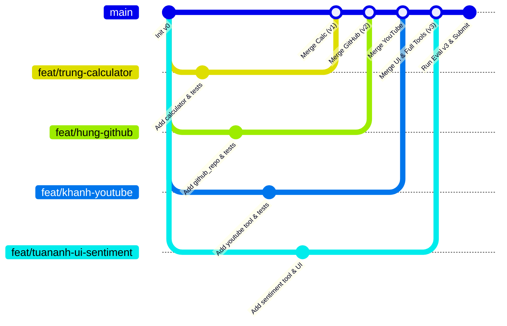

# Kế Hoạch Phân Công End-to-End (Vertical Slicing) — Day 03 Research Agent Tool Eval

**File:** `plan_h.md`  
**Nhóm trưởng:** DucTrung611  
**Thành viên:** Trần Mạnh Hùng (gitchung-mmm), khackhanh1201, phamtuananhhatay  
**Mục tiêu:** 4 thành viên cùng thực hiện chu trình phát triển Agent hoàn chỉnh (Code $\to$ Test $\to$ Prompt $\to$ Eval $\to$ Report) song song 100%, loại bỏ sự chờ đợi, đạt điểm tối đa và trọn vẹn điểm thưởng (Bonus).

---

## 1. Triết Lý Phân Công Mới (Vertical Slicing)

Thay vì chia theo "tầng kỹ thuật" (1 người chỉ làm prompt, 1 người chỉ làm tool, 1 người chỉ làm test) gây tắc nghẽn và phụ thuộc lẫn nhau, kế hoạch này chia theo **chu trình tính năng trọn gói (End-to-End Feature Ownership)**:

* Mỗi thành viên sở hữu **1 Tool mới hoàn toàn (để lấy Bonus $\ge 4$ tools)** + **2 Tool có sẵn**.
* Tự mình thực hiện toàn bộ 5 bước của vòng đời tool đó:
  1. **Code Tool**: Viết `tool.py` và `TOOL.md` chuẩn contract.
  2. **Unit Test**: Viết $\ge 3$ test cho tool mới + hoàn thành test cho 2 tool có sẵn trong `tests/test_tools_todo.py`.
  3. **Schema & Prompt**: Viết khai báo schema `tools.yaml` và quy tắc routing trong `system_prompt.md`.
  4. **Eval Cases**: Tự viết 2–3 test cases (single-turn + multi-turn) cho tool của mình vào `eval_group.json`.
  5. **Verify & Report**: Chạy verify, kiểm tra log và viết phần báo cáo liên quan.

---

## 2. Sơ Đồ Quy Trình Hoạt Động Song Song

```mermaid
flowchart TD
    subgraph SongSong ["4 LUỒNG LÀM VIỆC SONG SONG (TỰ CHỦ 100%)"]
        subgraph P1 ["DucTrung611 (Trưởng)"]
            T1_Code["Code: calculator"] --> T1_Test["Test: calculator, lookup, clarify"]
            T1_Test --> T1_Prompt["Khai báo: Prompt & YAML"]
            T1_Prompt --> T1_Eval["Eval: 2-3 Cases (cases_trung.json)"]
        end

        subgraph P2 ["Trần Mạnh Hùng"]
            T2_Code["Code: github_repo"] --> T2_Test["Test: github_repo, timeline, social_search"]
            T2_Test --> T2_Prompt["Khai báo: Prompt & YAML"]
            T2_Prompt --> T2_Eval["Eval: 2-3 Cases (cases_hung.json)"]
        end

        subgraph P3 ["khackhanh1201"]
            T3_Code["Code: youtube_transcript"] --> T3_Test["Test: youtube, fetch, policy"]
            T3_Test --> T3_Prompt["Khai báo: Prompt & YAML"]
            T3_Prompt --> T3_Eval["Eval: 2-3 Cases (cases_khanh.json)"]
        end

        subgraph P4 ["phamtuananhhatay"]
            T4_Code["Code: sentiment_analyzer"] --> T4_Test["Test: sentiment, send, format"]
            T4_Test --> T4_Prompt["Khai báo: Prompt & YAML"]
            T4_Prompt --> T4_Eval["Eval: 2-3 Cases (cases_tuananh.json)"]
            T4_Code --> UI_Dev["Dựng UI Streamlit (app.py) & Poster"]
        end
    end

    subgraph TichHop ["GIAI ĐOẠN HỘI TỤ & ĐO ĐẠC METRIC"]
        Merge_PR["Merge nhánh vào main & gộp Prompt / YAML / Eval"]
        Run_Eval["Chạy run_eval.py v1 -> v2 -> v3 (Lấy log JSON)"]
        Pytest_Check["pytest tests/ (0 failed, 0 skipped)"]
        Showdown_Submit["Demo UI 16:30 + Nộp REPORT.md hoàn chỉnh"]
    end

    P1 --> Merge_PR
    P2 --> Merge_PR
    P3 --> Merge_PR
    P4 --> Merge_PR

    Merge_PR --> Run_Eval
    Merge_PR --> Pytest_Check
    UI_Dev --> Showdown_Submit
    Run_Eval --> Showdown_Submit
    Pytest_Check --> Showdown_Submit
```



---

## 3. Bảng Phân Công Chi Tiết Từng Thành Viên

| Thành viên | Tool Mới (Bonus) | Tool Có Sẵn Kèm Theo | Nhiệm Vụ Chung Của Nhóm | Đầu Ra Cần Nộp (Deliverables) |
|---|---|---|---|---|
| **DucTrung611** *(Trưởng nhóm)* | **`calculator`**<br/>(Tính toán biểu thức toán, thống kê, số liệu tài chính) | • `lookup` (search web)<br/>• `clarify` (hỏi lại khi thiếu info) | • Setup `.env`, chạy baseline `v0`<br/>• Review & Merge PR của các thành viên<br/>• Chạy runner `run_eval.py` các mốc `v1, v2, v3`<br/>• Điền `version_log.csv` & REPORT B1, B2, B6 | • Thư mục `tools/calculator/`<br/>• `version_log.csv`, `runs/*.json`<br/>• Các hàm test `calculator`, `lookup`, `clarify`<br/>• 3 eval cases |
| **Trần Mạnh Hùng** | **`github_repo`**<br/>(Tra cứu thông tin repository, README, release, issues) | • `timeline` (lấy tweet tài khoản)<br/>• `social_search` (tìm tweet chủ đề) | • Quản lý contract `test_tool_contract.py` luôn xanh<br/>• Đăng ký các tool mới vào `tools/__init__.py` | • Thư mục `tools/github_repo/`<br/>• Các hàm test `github_repo`, `timeline`, `social_search`<br/>• 3 eval cases (xử lý bỏ `@` ở username) |
| **khackhanh1201** | **`youtube_transcript`**<br/>(Lấy phụ đề/nội dung text từ video Youtube) | • `fetch` (đọc bài viết từ URL)<br/>• `policy` (tra cứu tài liệu nội bộ) | • Rà soát input biên toàn bộ test suite (`limit=0`, `top_k=0`, rỗng...) để săn bug đạt mục B5 | • Thư mục `tools/youtube_transcript/`<br/>• Các hàm test `youtube_transcript`, `fetch`, `policy`<br/>• 3 eval cases (phân biệt link youtube vs link web thường)<br/>• REPORT B3 + B5 (test) |
| **phamtuananhhatay** | **`sentiment_analyzer`**<br/>(Phân tích cảm xúc tích cực/tiêu cực/trung tính của bài viết) | • `send` (gửi Telegram + confirm guardrail)<br/>• `format` (tổng hợp bản tin markdown) | • Dựng giao diện **UI Streamlit (`app.py`)**<br/>• Mở Cloudflare Tunnel lấy URL demo<br/>• Hoàn thành **REPORT Phần A (A1-A3)** trước 16:30<br/>• Chạy live chat `chat.py` $\ge 3$ lượt | • Thư mục `tools/sentiment_analyzer/`<br/>• File `app.py` + link demo<br/>• File `poster.html` (hoặc `poster.svg`)<br/>• Các hàm test `sentiment`, `send`, `format`<br/>• 3 eval cases (guardrail confirmation) |

---

## 4. Quy Chuẩn Kỹ Thuật Cho Mỗi Người (5 Bước Chi Tiết)

### Bước 1: Code Tool mới (`tools/<tên_tool>/`)
* Tạo thư mục `tools/<tên_tool>/`.
* File `tool.py`: Hàm nhận tham số rõ ràng, xử lý exception và luôn trả về `dict`, không bao giờ `raise` làm crash chương trình.
* File `TOOL.md`: Khai báo metadata đúng chuẩn frontmatter:
  ```yaml
  ---
  name: <tên_tool>
  track: bonus
  kind: live_api | local_formatter | local_knowledge | action
  inputs: [param1, param2]
  outputs: [result_field]
  side_effect: false
  ---
  ```

### Bước 2: Viết Unit Test (`tests/test_tools_todo.py`)
* Mỗi người tự hoàn thành các hàm test của mình trong [tests/test_tools_todo.py](file:///d:/BT%20VinUni/K5-L3-DAY03-ThanDucTrung-2A202603449-ResearchAgentToolEval/starter_v0/tests/test_tools_todo.py).
* Quy tắc:
  * 1 test happy path (đầu vào chuẩn).
  * 1 test bad input (chuỗi rỗng, sai kiểu dữ liệu, ngoài enum).
  * 1 test failure path (lỗi mạng, thiếu API key $\to$ trả dict error).
  * Dùng `fake_http` từ `conftest.py` để mock, **tuyệt đối không gọi mạng thật**.

### Bước 3: Soạn đoạn khai báo `tools.yaml` & Quy tắc Prompt
Mỗi người tự chuẩn bị sẵn 2 đoạn text vào file nháp trên nhánh của mình:
1. **Schema YAML** (`tools.yaml`):
   * `name`, `description` (nêu rõ **công dụng, khi nào dùng, khi nào KHÔNG ĐƯỢC dùng**).
   * Quy ước tham số (`default`, `enum`, hướng dẫn format).
2. **Prompt Rule** (`system_prompt.md`):
   * Quy tắc định tuyến 1-2 câu ngắn gọn: Ví dụ *"Khi người dùng yêu cầu tính toán con số, luôn gọi calculator thay vì tự nhẩm"*.

### Bước 4: Viết Eval Cases (`data/cases_<tên>.json`)
Mỗi người tạo file case riêng (2–3 case):
```json
{
  "id": "GRP_01_<tên_case>",
  "phase": "B",
  "query": "Câu hỏi test của user...",
  "failure_type": "wrong_tool",
  "expect": {
    "tool_calls": [
      {
        "name": "<tên_tool>",
        "args": {"param": "value"}
      }
    ]
  },
  "metadata": {
    "what_it_tests": "Mô tả mục đích test case này"
  }
}
```
*Tổng cả nhóm sẽ có $4 \times 3 = 12$ eval cases (vượt chỉ tiêu yêu cầu 10 cases!)*.

### Bước 5: Chạy Verify & Viết Report
* Chạy `pytest -v tests/test_tools_todo.py` kiểm tra các test của mình xanh.
* Điền thông tin vào các mục REPORT tương ứng.

---

## 5. Chiến Lược Git & Tránh Xung Đột (Merge Mượt Mà)



1. **Phân chia vùng code trong `tests/test_tools_todo.py`**:
   * DucTrung: hàm `test_clarify_*`, `test_lookup_*`, `test_calculator_*`.
   * Hùng: hàm `test_timeline_*`, `test_social_search_*`, `test_github_*`.
   * Khánh: hàm `test_fetch_*`, `test_policy_*`, `test_youtube_*`.
   * Tuấn Anh: hàm `test_format_*`, `test_send_*`, `test_sentiment_*`.
   *(Nhờ chia rõ các hàm, git merge sẽ tự động khớp mà không bị conflict)*.

2. **Gộp `data/eval_group.json`**:
   * Mỗi người lưu case vào `data/cases_<tên>.json`.
   * Khi merge vào `main`, DucTrung chỉ cần copy các case vào mảng `"cases": [...]` của `data/eval_group.json`.

3. **Gộp `system_prompt.md` & `tools.yaml`**:
   * Mỗi người gửi đoạn text mô tả của mình vào group.
   * DucTrung dán vào file chính theo từng version để đo đạc `v1` $\to$ `v2` $\to$ `v3`.

---

## 6. Mốc Thời Gian Thực Hiện Trong Ngày (Checkpoints)

| Thời gian | Mục tiêu của 4 thành viên | Người phụ trách chính |
|---|---|---|
| **09:30 – 10:00** | • Setup repo, tạo 4 nhánh `feat/<tên>`<br/>• Chạy thử preflight và baseline v0 | Cả nhóm / DucTrung |
| **10:00 – 11:30** | • 4 người code xong 4 tool mới (`tool.py`, `TOOL.md`)<br/>• Viết xong các unit test tương ứng trong `test_tools_todo.py` | Song song 4 người |
| **11:30 – 12:30** | • Kiểm tra `pytest` cục bộ trên từng máy<br/>• Viết xong 2-3 eval cases cho mỗi người<br/>• Tuấn Anh dựng xong layout cơ bản của Streamlit UI | Song song 4 người |
| **13:30 – 14:30** | • Merge PR các nhánh vào `main`<br/>• Gộp `eval_group.json`, `tools.yaml`, `system_prompt.md`<br/>• Chạy benchmark `v1`, `v2` | DucTrung chủ trì gộp |
| **14:30 – 15:30** | • Tối ưu prompt đạt bản **v3** (độ chính xác cao nhất)<br/>• Chạy eval suite `group` trên bản v3<br/>• Đảm bảo `pytest` đạt **0 failed, 0 skipped** | DucTrung & Khánh |
| **15:30 – 16:30** | • Chạy live chat `chat.py` $\ge 3$ lượt lấy transcript<br/>• Kết nối UI Streamlit với Cloudflare Tunnel<br/>• **HOÀN THÀNH REPORT PHẦN A (A1–A3) + POSTER TRƯỚC 16:30** | Tuấn Anh & Cả nhóm |
| **16:30 – 17:15** | • **Team Showdown**: Demo sản phẩm cho zone xem | Tuấn Anh & DucTrung |
| **17:15 – 18:00** | • Điền nốt Phần B [REPORT.md](file:///d:/BT%20VinUni/K5-L3-DAY03-ThanDucTrung-2A202603449-ResearchAgentToolEval/starter_v0/artifacts/REPORT.md) (Bảng v0-v3, failure analysis, reflection)<br/>• Nộp bài hoàn tất | Cả nhóm |

---

## 7. Tiêu Chí Nghiệm Thu (Definition of Done)

- [ ] Có đầy đủ 4 tool mới có `tool.py` + `TOOL.md` + đăng ký `tools/__init__.py`.
- [ ] `pytest tests/` đạt kết quả: **0 failed, 0 skipped**.
- [ ] File `data/eval_group.json` có $\ge 10$ test cases chất lượng.
- [ ] Đo đạc đầy đủ các phiên bản `v0`, `v1`, `v2`, `v3` trong `artifacts/version_log.csv` và `runs/*.json`.
- [ ] Giao diện UI Streamlit chạy mượt mà, có cơ chế xác nhận trước khi `send`.
- [ ] Báo cáo `artifacts/REPORT.md` hoàn thành đầy đủ cả Phần A và Phần B.
